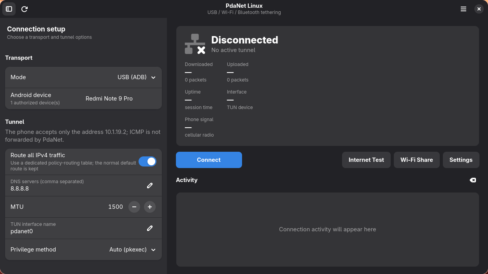
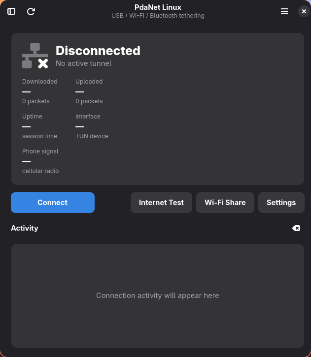
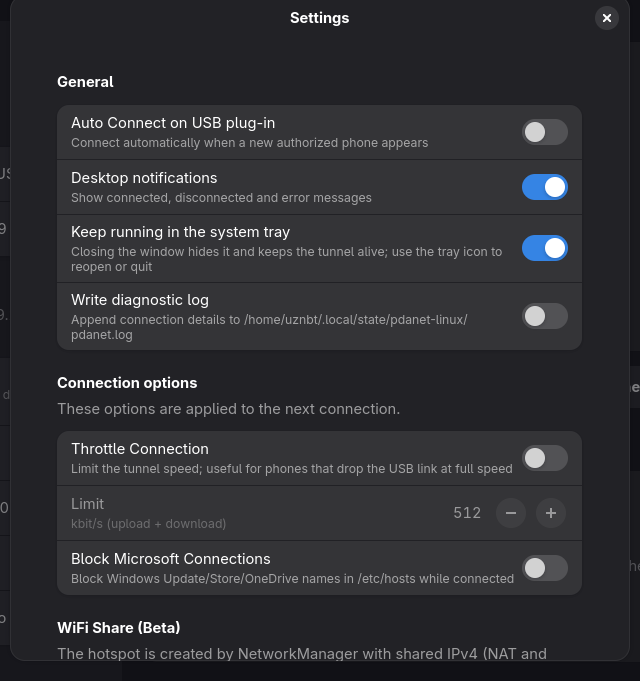

<p align="center">
  
</p>

# PdaNet Linux

[](LICENSE)
[](pyproject.toml)
[](https://www.gtk.org)

An unofficial Linux client for **PdaNet+** USB, Wi-Fi and Bluetooth tethering,
with a GTK4/libadwaita GUI and a command-line interface. It can also run in
reverse: a phone joins a laptop hotspot and uses PdaNet's client mode to
reach the Internet through the laptop.

The client exposes a Linux TUN interface and relays raw IPv4 packets to the
PdaNet server running on an Android phone. TCP and UDP are handled by the
phone's user-space network stack; the phone does not proxy ICMP.

> **Status:** the USB transport and TUN data path have been validated live
> with a Redmi Note 9 Pro: init/model handshake, DNS, TCP and UDP all work
> through the tunnel. Wi-Fi and Bluetooth still need live validation; the
> Bluetooth link also needs a fresh pairing because the phone currently
> holds a one-sided bond. The reverse PdaNet server is implemented and unit
> tested, but its live session is also pending because this machine's Wi-Fi
> radio is currently soft-blocked. See [Verification](#verification) before
> relying on it.
>
> The PdaNet Desktop feature set is implemented in the GUI and CLI: tray-menu
> actions, a StatusNotifierItem tray icon with close-to-background behaviour,
> settings, WiFi Share, Reverse PdaNet, pairing dialogs, auto-connect,
> throttling, Microsoft blocking, Internet Test, help and logging. The
> dashboard and tray can also show the phone's cellular operator, radio
> technology, signal bars and RSRP when ADB telemetry is available. See the
> [feature map](#pdanet-desktop-feature-map).

This project is not affiliated with PdaNet/FoxFi. It does not bypass
registration, licensing, or carrier restrictions, and it requires the
phone-side PdaNet app to be running and licensed normally.

---

## Screenshots



<p align="center">
  
</p>

<p align="center">
  
</p>

The screenshots use the default Adwaita dark palette with the blue accent,
not a desktop-specific theme. They show the disconnected state; traffic,
uptime and the phone signal appear after a transport is connected.

---

## Features

- **USB via ADB** — `adb forward` to TCP `8739`, with a fallback to the
  abstract socket `localabstract:pdanet`.
- **Wi-Fi** — direct TCP connection to port `8740` and UDP discovery on
  port `8000`.
- **Bluetooth** — RFCOMM connection to the phone's `PdaNet Server` service,
  with SDP channel discovery and a channel-probing fallback. Scans log the
  controller state, every device's paired/trusted/connected flags, whether
  the PdaNet SDP service is advertised, and any `bluetoothctl` error.
- **Raw IPv4 TUN** — interface address `10.1.19.2/24`, MTU `1500`.
- **Phone signal** — best-effort operator, LTE/5G technology, signal bars,
  RSRP, RSRQ and SNR from Android telephony telemetry over ADB. Shown in the
  dashboard, the tray menu/tooltip and an optional tray overlay icon. It never
  affects the tunnel and is simply unavailable when ADB is not present.
- **IPv6 leak guard** — the tunnel carries IPv4 only, so an unreachable IPv6
  default is installed in the policy table while ULA, link-local, multicast
  and on-link global prefixes stay on the local network. This prevents IPv6
  traffic from silently bypassing PdaNet over Wi-Fi without breaking IPv6 LAN
  access.
- **Policy routing** — a dedicated table (`51820`) and a policy rule
  (`15010`) carry the default route, so the system's main default route is
  never replaced. The rule preference is below the kernel's `main` rule
  (`32766`), which is required for the tunnel to win when Wi-Fi also has a
  default route.
- **LAN preservation** — higher-priority rules (`15000`) keep RFC1918,
  link-local, multicast and broadcast destinations on the normal network.
  The phone's PdaNet stack drops private destinations anyway.
- **Privilege separation** — the GUI/CLI and `adb` run as the desktop user.
  A small root helper creates the TUN interface, routes and DNS settings,
  then passes the TUN file descriptor back over `SCM_RIGHTS`.
- **GTK4 / libadwaita GUI** — a two-pane desktop layout: connection setup
  on the left, live status/traffic/signal dashboard and activity log on the
  right. In narrow or tiled windows the sidebar collapses and is available
  from the header button. Includes USB, Wi-Fi and Bluetooth mode selection,
  device selection, Wi-Fi discovery, live counters and uptime.
- **PdaNet Desktop menu parity** — Connect USB/Wi-Fi/Bluetooth, Disconnect,
  WiFi Share (Beta), Settings, Bluetooth Pairing, WiFi Pairing, auto-connect,
  Microsoft blocking, throttling, Internet Test, Online Help, About and Exit.
- **Auto Connect on USB plug-in** — polls `adb devices` and connects when a
  new authorized phone appears, without reconnecting after a manual
  disconnect.
- **Throttle Connection** — shared token bucket applied to both directions.
- **Block Microsoft Connections** — managed `/etc/hosts` section, installed
  and removed by the root helper around the tunnel.
- **WiFi Share (Beta)** — NetworkManager AP with shared IPv4 (NAT and DNS)
  to share any Internet connection on this computer (Ethernet, Wi-Fi or a
  PdaNet tunnel) with phones and tablets. It does not require PdaNet client
  mode on the phone.
- **Reverse PdaNet server** — the opposite direction: the phone joins a
  hotspot created by this computer and uses PdaNet's
  **Connect to a PdaNet Hotspot** mode. The laptop runs the UDP discovery
  responder (`8000`), TCP server (`8740`), TUN (`10.1.19.1/24`), IPv4
  forwarding and NAT, so the phone reaches the Internet through the
  laptop's normal upstream. Available from the GUI and
  `pdanet-linux serve start|status|stop`.
- **Internet Test** — TUN, system DNS, UDP DNS, TCP and HTTPS checks with
  copyable results, also available as `pdanet-linux test`.
- **Optional diagnostic log** — `$XDG_STATE_HOME/pdanet-linux/pdanet.log`.
- **CLI** — `devices`, `discover`, `signal`, `bt-devices`, `bt-scan`,
  `connect`, `test`, `wifi-scan`, `wifi-connect`, `share start|stop|status`,
  `serve start|status|stop`, `doctor`, and `gui`.
- **Offline protocol simulator** — `pdanet_linux/mock_server.py`.

### PdaNet Desktop feature map

| PdaNet Desktop | PdaNet Linux |
|---|---|
| Connect USB / WiFi / Bluetooth | Same transports; USB via adb, WiFi via TCP, Bluetooth via RFCOMM |
| Disconnect | Disconnects and removes routes, DNS, hosts block and TUN |
| WiFi Share (Beta) | NetworkManager access point with shared IPv4 (NAT + DNS); shares any upstream |
| Reverse PdaNet | Laptop hotspot + discovery/TCP server + TUN forwarding/NAT for the phone's PdaNet client mode |
| Settings | Linux-relevant options in the GUI; Windows Mobile/RAS rows are marked not applicable |
| Bluetooth Pairing | Scan/pair/trust dialog using BlueZ |
| WiFi Pairing | `nmcli` scan/join dialog; the gateway becomes the phone IP |
| Windows Hotspot Settings | Mapped to WiFi Share (Windows Settings page does not exist) |
| Auto Connect on USB Plug-in | `adb devices` polling with new-device detection |
| Block Microsoft Connections | Marked `/etc/hosts` section installed/removed by the helper |
| Throttle Connection | Shared token bucket for both directions |
| Internet Test | Tunnel/DNS/UDP DNS/TCP/HTTPS checks with copy-to-clipboard |
| Online Help | Built-in help and link to the official PdaNet FAQ |
| About / Exit | Same |
| Hidden `c:\pdanet.log` logging | Optional `$XDG_STATE_HOME/pdanet-linux/pdanet.log` |

Windows-only features that cannot be meaningfully ported are intentionally
not emulated: the USB driver installer, Windows RAS/dial-up entries,
"Maximum Speed" for Palm/Treo serial links, the Treo screen option, Windows
hosted-network APIs, and desktop registration/activation. Licensing and
registration remain with the phone-side PdaNet app.

---

## Why not a custom kernel driver?

The communication path already uses the kernel: `/dev/net/tun` is a kernel
TUN driver, and every packet from PdaNet is handed to the Linux network stack
through it. The part that is not in the kernel is PdaNet's proprietary framed
IPv4 protocol over ADB/TCP/RFCOMM, which is implemented in userspace. A
kernel module would not remove that work; it would add a second component
that has to speak the same protocol or forward to the existing userspace
client.

A custom netdev module could declare `ARPHRD_ETHER` and make NetworkManager
and desktop shells display an Ethernet/cable icon, which is how Windows
PdaNet's `pneteth.sys` works. That is a presentation and driver-model
difference, not a faster communication path. It would require an
out-of-tree/DKMS module, a kernel-version compatibility matrix, Secure Boot
signing, and kernel crash risk, while the TUN path is already fast enough for
phone tethering.

The Windows `pneteth.sys` cannot be reused: it is an NDIS miniport for the
Windows kernel, not a Linux network device. Linux has no generic API that
turns a TUN interface into an Ethernet interface; TAP, veth, bridge and dummy
devices also remain distinct NetworkManager types, and shells that filter on
`/sys/class/net/<iface>/device` still will not treat them as physical
Ethernet. The realistic alternatives are:

1. Keep the TUN client and show the connection state through the PdaNet
   dashboard/tray (the current approach).
2. Use the phone's USB RNDIS/CDC-ECM/NCM tethering instead, which Linux
   already sees as a real Ethernet-like device, but that is a different phone
   feature, not PdaNet's tunnel.
3. Write and maintain a virtual Ethernet netdev kernel module plus a
   userspace protocol daemon. This is more work, more fragile, and makes the
   system less portable than the current TUN design.

In short: the kernel communication path exists; rebuilding it as a custom
driver would not avoid writing the PdaNet client, and it would add
maintenance and security cost for an icon.

---

## Reverse-engineered protocol

The protocol was reconstructed from the decompiled Android package
`com.pdanet` 5.23 (APK `PdaNet5232.apk`). The Windows file in the package
is an installer and was not needed for the protocol.

### Framing

Every frame starts with a 32-byte header of eight 32-bit integers. The two
directions use different wire byte orders:

| Direction | Struct | Fields |
|---|---|---|
| Client → phone | `>8I` (big-endian) | command, token, connection, length, extra0, extra1, extra2, flags |
| Phone → client | `<8I` (little-endian) | command, arg, connection, sequence, length, status, extra0, extra1 |

The Android client reaches the client→phone layout through a double swap:
it byte-swaps the logical values before writing them little-endian, while
the server reads the header big-endian. A header whose logical command is
`15` and Wi-Fi flag is `64` therefore starts with `00 00 00 0f` and ends
with `00 00 00 40`.

### Handshake

1. **Init** — command `15` with a transport flag:
   - `64` = Wi-Fi (used by the Android tablet client)
   - `256` = USB (mapped to transport id 1 by `com.pdanet.d.run`)
   - `4` = Bluetooth (the phone maps `h & 4` to Bluetooth mode)
   - `128`/`512` = alternate transports
2. **Model** — command `302` with the client name encoded as UTF-16LE
   (no BOM, no terminator). The phone displays this name in its client list.
3. **Tunnel** — command `64` with a raw IPv4 datagram immediately after the
   header.

The first packet must be the init packet; the server ignores later packets
until it has processed it. The client sends init and model back to back.
The server may send informational type `3`/`9` packets on USB; they can be
ignored (the reference Android client does the same).

### Server-side behavior

- The TUN address must be `10.1.19.2`; the phone drops IPv4 packets whose
  source address is not exactly that value.
- The phone implements TCP and UDP in user space. ICMP is not handled, so
  `ping` and `traceroute` do not work through PdaNet.
- RFC1918 destinations (`10/8`, `172.16/12`, `192.168/16`, `169.254/16`)
  are ignored by the phone's IP handler. Private traffic should stay on the
  local network.
- Non-init payloads larger than `10240` bytes are rejected by the server.
  An MTU of `1500` is comfortably below that.
- The Android VPN service configures `10.1.19.2/24`, MTU `1500`, and DNS
  `8.8.8.8`.

### Transports

- **USB:** `adb forward tcp:<port> tcp:8739`; if the phone listens on the
  abstract socket instead, `adb forward tcp:<port> localabstract:pdanet`.
  `adb` always runs as the desktop user.
- **Wi-Fi:** TCP `8740`. Discovery sends a 64-byte UDP datagram to port
  `8000` with marker `5014` and the client model at offset 32. The reply's
  source address is used as the phone address; the reply name is ASCII at
  offset 32.
- **Bluetooth:** RFCOMM. PdaNet registers the service with
  `listenUsingRfcommWithServiceRecord("PdaNet Server",
  UUID.fromString("00002A0B-0000-1000-8000-00805F9B34FB"))` in
  `com.pdanet.a`. The client first asks the phone's SDP server for the
  RFCOMM channel through L2CAP PSM 1, optionally falls back to `sdptool`,
  and finally probes channels 1–30. The data stream uses the same 32-byte
  PdaNet framing as the other transports. BlueZ `bluetoothctl` handles
  pairing and link state; the data path uses Python's built-in
  `AF_BLUETOOTH`/`BTPROTO_RFCOMM` socket support, so PyBluez is not needed.

### Reverse server (phone client mode)

The phone's **Connect to a PdaNet Hotspot** mode is a PdaNet client. It
finds a server by sending a 64-byte UDP datagram to the DHCP gateway on port
`8000`, then opens TCP `8740`. The reverse server mirrors the phone server's
quirks:

- The discovery answer is 64 bytes: marker `5014` in little-endian at
  offset 0, server IPv4 at 4, client IPv4 at 8, MAC text at 12 and the
  server name at 32. The phone client reads the marker big-endian and
  byte-swaps it, so the reply must be written little-endian.
- The phone sends the same client header and handshake as the desktop
  client: init type `15` with flag `64`, model type `302` UTF-16LE, then
  raw IPv4 type `64`.
- Raw IP from the laptop uses the little-endian `ServerHeader`, command
  `64`. The phone writes the payload into its VPN TUN (`10.1.19.2/24`).
- The server TUN is `10.1.19.1/24`; packets from the phone must have source
  `10.1.19.2` and are otherwise dropped.

---

## Requirements

- Linux with TUN support (`/dev/net/tun`) and `iproute2`
- Python 3.10 or newer
- `adb` from the Android platform tools
- `polkit`/`pkexec` (recommended) or `sudo`
- For the GUI: PyGObject, GTK 4 and libadwaita
- For Bluetooth: BlueZ (`bluetoothctl`), a running `bluetooth` service and
  kernel RFCOMM support
- For WiFi Pairing and WiFi Share: NetworkManager with `nmcli`
- For reverse PdaNet: `iptables` (the nftables backend is fine) and
  `/proc/sys/net/ipv4/ip_forward`, plus an AP-capable Wi-Fi adapter
- Optional desktop notifications: `notify-send` from libnotify
- PdaNet+ running on the phone, with USB debugging enabled for USB mode
  and Bluetooth tethering enabled for Bluetooth mode

The Bluetooth helper uses `sdptool` when it is installed, but this is
optional. On Arch Linux it lives in `bluez-deprecated-tools`; the built-in
SDP client and RFCOMM probing work without it.

Install examples:

```bash
# Debian / Ubuntu
sudo apt install python3 android-sdk-platform-tools-common adb iproute2 \
    policykit-1 python3-gi gir1.2-gtk-4.0 gir1.2-adw-1 bluez \
    network-manager libnotify-bin iptables

# Fedora
sudo dnf install python3 android-tools iproute polkit \
    python3-gobject gtk4 libadwaita bluez NetworkManager libnotify \
    iptables

# Arch Linux
sudo pacman -S python android-tools iproute2 polkit \
    python-gobject gtk4 libadwaita bluez bluez-utils networkmanager \
    libnotify iptables-nft
```

Package names vary by distribution; `adb` is often in
`android-tools-adb` or `android-sdk-platform-tools`.

---

## Installation

### System installation (recommended)

```bash
cd pdanet-linux
sudo ./tools/install.sh
```

This installs:

- `pdanet-linux` (CLI and GUI launcher)
- the root helper at `/usr/local/libexec/pdanet-linux-helper`
- the polkit action, desktop entry and icon

The helper imports the Python package while running as root, so the
installer makes `/usr/local/lib/pdanet-linux` owned by `root` and removes
group/world write access. Do not replace that directory with a user-owned
copy (`cp -r pdanet_linux ...`); always reinstall with `sudo
./tools/install.sh`.

Remove it with:

```bash
sudo ./tools/uninstall.sh
```

### Python package only (development)

```bash
cd pdanet-linux
python3 -m pip install -e .
```

This installs the Python entry points but not the root helper. The client
will refuse to create a TUN device until the system installer has run, or
until the whole client is started as root.

---

## Usage

### GUI

```bash
pdanet-linux gui
```

or launch **PdaNet Linux** from the application menu.

1. Choose **USB (ADB)**, **Wi-Fi** or **Bluetooth**.
2. For USB, connect the phone, unlock it and approve the USB debugging
   prompt. Press the refresh button if the device list is empty.
3. For Wi-Fi, connect the PC to the phone's hotspot. Use **Discover hotspot**
   or enter the phone IP (usually `192.168.49.1`).
4. For Bluetooth, enable Bluetooth tethering in PdaNet+ and open the
   phone's Bluetooth settings so it is discoverable. Select the phone in the
   **Bluetooth device** list; if the list is empty, press **Scan**. The app
   also scans automatically when no phone has been paired yet. Selecting an
   unpaired phone and pressing **Connect** asks BlueZ to pair it first.
5. Click **Connect** and authenticate the polkit prompt.

While connected, the dashboard also shows the phone's cellular signal
(operator, LTE/5G technology, bars and RSRP/RSRQ/SNR) when an authorized ADB
device is available. The same value appears in the tray tooltip and in the
disabled **Phone signal** tray menu item; hosts that support
`OverlayIconName` also get a small signal-bars overlay. The signal reader is
best effort: a missing ADB device, a locked phone or an OEM that hides
telephony telemetry only hides the signal, never the tunnel. Polling happens
every 15 seconds while connected.

The header menu contains the same actions as the PdaNet Desktop tray menu:

- **Connect USB / Connect WiFi... / Connect Bluetooth / Disconnect** switch
  transports. Switching while connected disconnects first, then reconnects.
- **WiFi Share (Beta)...** creates a NetworkManager access point and shares
  this computer's current Internet connection (Ethernet, Wi-Fi or PdaNet).
  The adapter must support AP mode.
- **Reverse PdaNet...** creates a hotspot, TUN and PdaNet server so a phone
  can use this computer's Internet through PdaNet's client mode.
- **Settings** controls auto-connect, notifications, the diagnostic log,
  close-to-tray behaviour, throttling, Microsoft blocking and the default
  WiFi Share SSID.
- **Bluetooth Pairing...** scans, pairs and trusts a phone.
- **WiFi Pairing...** scans and joins a Wi-Fi network through NetworkManager,
  then stores its gateway as the phone IP.
- **Windows Hotspot Settings...** is mapped to WiFi Share because the Windows
  mobile-hotspot settings page does not exist on Linux.
- **Internet Test**, **Online Help**, **About** and **Exit**.
- **Hide to Tray** hides the window without stopping the tunnel; **Exit**
  disconnects, cleans up and quits.

The GUI also registers a StatusNotifierItem system-tray icon with the same
menu. By default, closing the window hides it and keeps the tunnel running,
like PdaNet for Windows. Click the tray icon (or choose **Show PdaNet**) to
restore the window, or use **Quit PdaNet** in the tray menu to stop the
tunnel and exit. This behaviour can be disabled in **Settings**. If the
desktop provides no StatusNotifierWatcher (for example a bare window manager
without a tray host), closing the window exits normally instead of hiding an
unreachable window.

The **Auto Connect on USB Plug-in**, **Block Microsoft Connections** and
**Throttle Connection** menu items are checkboxes and are saved immediately.
Auto-connect deliberately ignores a phone that was already attached when the
option was enabled. The Microsoft block is applied to `/etc/hosts` for the
next connection and removed on disconnect. Throttling defaults to 512 kbit/s
and can be changed in Settings.

WiFi Share and WiFi Pairing rely on `nmcli`; the installer checks for
NetworkManager. The hotspot profile is named `pdanet-share` and is removed
when the GUI exits.

#### Pairing the phone over Bluetooth

Pairing is a one-time step. The app can request pairing when you select an
unpaired phone, but the most reliable method is to run `bluetoothctl`
interactively so the pairing agent can ask for confirmation:

```text
$ bluetoothctl
[bluetooth]# scan on
# Wait until "Redmi Note 9 Pro" (or your phone) appears, then:
[bluetooth]# pair 7C:2A:DB:B9:3D:65
[bluetooth]# trust 7C:2A:DB:B9:3D:65
[bluetooth]# connect 7C:2A:DB:B9:3D:65
[bluetooth]# quit
```

Keep the phone's Bluetooth settings screen open while pairing so the phone
is discoverable, and confirm the pairing code on both devices. If
`bluetoothctl` reports `br-connection-key-missing`, the stored link key is
stale. Remove the pairing on the PC with `bluetoothctl remove ADDRESS`,
choose **Forget** for the PC on the phone, and pair again. The phone and PC
must use the same Bluetooth adapter that was paired; switching adapters
invalidates the link key.

### CLI

```bash
pdanet-linux doctor
pdanet-linux devices
pdanet-linux discover
pdanet-linux signal
pdanet-linux signal --serial R58M123ABC
pdanet-linux bt-devices
pdanet-linux bt-scan

# USB, automatic device selection
pdanet-linux connect --usb

# USB, explicit device
pdanet-linux connect --serial R58M123ABC

# Wi-Fi
pdanet-linux connect --host 192.168.49.1

# Bluetooth, single paired phone
pdanet-linux connect --bluetooth

# Bluetooth, explicit phone (pairs it first if needed)
pdanet-linux connect --bluetooth --bt-device 7C:2A:DB:B9:3D:65

# Bluetooth, explicit phone and RFCOMM channel
pdanet-linux connect --bluetooth --bt-device 7C:2A:DB:B9:3D:65 --bt-channel 3

# Handshake only, no TUN device and no root
pdanet-linux connect --bluetooth --dry-run

# Internet Test while connected
pdanet-linux test

# Scan and join a Wi-Fi network (PdaNet hotspot or any other)
pdanet-linux wifi-scan
pdanet-linux wifi-connect "PdaNet Hotspot" --password "secret123"

# WiFi Share (NetworkManager AP); stop it again when finished
pdanet-linux share start --ssid "PdaNet Share" --password "secret123"
pdanet-linux share status
pdanet-linux share stop

# Reverse PdaNet: the phone uses this computer's Internet (PdaNet client mode)
pdanet-linux serve start --ssid "Laptop Hotspot"
pdanet-linux serve status
pdanet-linux serve stop

# Throttle and Microsoft blocking for the next connection
pdanet-linux connect --usb --throttle 512 --block-microsoft
```

Useful options:

| Option | Meaning |
|---|---|
| `--no-route` | create the TUN device but do not install the default route |
| `--no-dns` | leave the system DNS configuration unchanged |
| `--dns IP` | DNS server inside the tunnel (repeatable, default `8.8.8.8`) |
| `--throttle KBPS` | limit total tunnel throughput in kbit/s (`0` = unlimited) |
| `--block-microsoft` | block Microsoft update/telemetry names in `/etc/hosts` |
| `--mtu N` | TUN MTU (default `1500`) |
| `--bluetooth` | use the Bluetooth RFCOMM transport |
| `--bt-device VALUE` | Bluetooth MAC address or device-name substring |
| `--bt-channel N` | RFCOMM channel (default `0` = discover through SDP) |
| `--usb-flag N` | init transport flag for USB (default `256`) |
| `--wifi-flag N` | init transport flag for Wi-Fi (default `64`) |
| `--bt-flag N` | init transport flag for Bluetooth (default `4`) |
| `--privilege MODE` | `auto`, `pkexec`, `sudo`, or `root` |
| `--local-port N` | local port for `adb forward` (default: choose a free port) |
| `-v` | log forwarded IP packets and server messages |
| `--dry-run` | connect and handshake only |

Press `Ctrl+C` to disconnect. The helper removes the routing rules, the
routing table entries and the TUN interface when the client exits, including
on a crash (the helper sees the control socket close).

### Reverse PdaNet (phone uses this computer's Internet)

Normal PdaNet has the phone acting as the server and the computer as the
client. **Reverse PdaNet** is the opposite direction and is compatible with
PdaNet+'s phone-side **Connect to a PdaNet Hotspot** mode:

```text
phone Wi-Fi ──► laptop hotspot (NetworkManager) ──► PdaNet TCP 8740
                                                   ──► laptop TUN 10.1.19.1/24
                                                   ──► IPv4 forward + NAT
                                                   ──► laptop uplink
```

**GUI:** open the header menu → **Reverse PdaNet...**, choose the hotspot
name/password (or leave the password blank to generate one), then press
**Start Reverse PdaNet**. Closing the dialog stops the server, TUN and any
hotspot it created.

**CLI:**

```bash
# Create/reuse the hotspot, TUN and server; Ctrl+C stops everything
pdanet-linux serve start --ssid "Laptop Hotspot"

# Use an existing NetworkManager hotspot named pdanet-share
pdanet-linux serve start --no-hotspot

# Keep the hotspot after Ctrl+C (the TUN and firewall rules are still removed)
pdanet-linux serve start --keep-hotspot

# Manage a server started in another terminal
pdanet-linux serve status
pdanet-linux serve stop
```

On the phone:

1. Connect to the laptop hotspot. If `serve start` generated a password,
   it is printed once and also shown by `serve status`.
2. Open PdaNet+ on the phone and choose **Connect to a PdaNet Hotspot**.
3. Approve Android's VPN request. The phone now sends its traffic through
   the laptop.

The laptop needs `net.ipv4.ip_forward=1` (enabled temporarily and restored
on exit) and `iptables` rules in dedicated `PDANET_SRV` chains. NAT applies
only to `10.1.19.0/24`; the FORWARD chain accepts only the phone address
`10.1.19.2` and related return traffic. `--no-nat` is available for a
routed setup, but then the upstream router must know a route back to
`10.1.19.0/24`.

Useful `serve start` options:

| Option | Meaning |
|---|---|
| `--ssid NAME` | hotspot name (default `PdaNet Laptop`) |
| `-p`, `--password TEXT` | WPA2 password; blank generates one |
| `--interface IFACE` | Wi-Fi interface for the hotspot (default: auto) |
| `--no-hotspot` | require and reuse the existing `pdanet-share` hotspot |
| `--keep-hotspot` | leave the hotspot running after the server stops |
| `--listen ADDR` | TCP listen address (default `0.0.0.0`) |
| `--port N` | TCP port (default `8740`) |
| `--discovery-port N` | UDP discovery port (default `8000`) |
| `--tun NAME` | TUN interface name (default `pdanet0`) |
| `--mtu N` | TUN MTU (default `1500`) |
| `--name NAME` | server name shown by PdaNet (default: hostname) |
| `--allow CIDR` | extra client subnet allowed to connect (repeatable) |
| `--no-nat` | do not add MASQUERADE rules |
| `--privilege MODE` | `auto`, `pkexec`, `sudo`, or `root` |

**Single-radio limitation.** A laptop with one Wi-Fi adapter cannot be an
access point and a client of the same phone hotspot at the same time. For
reverse PdaNet the laptop is the access point and its Internet comes from
Ethernet, another Wi-Fi adapter, or a PdaNet USB/Bluetooth link. Sharing
the same phone's PdaNet USB link through the hotspot works, but the traffic
then makes an unnecessary round trip through the phone. For ordinary
sharing, **WiFi Share** already shares any upstream and needs no PdaNet
client mode on the receiving device.

---

## How the routing works

For a full-tunnel connection:

```text
ip rule add pref 15000 to <private ranges> lookup main
ip rule add pref 15010 lookup 51820
ip route replace default dev pdanet0 table 51820
ip route replace <phone>/32 via <gateway> dev <wifi> table 51820
```

The `main` table and its default route are left untouched. The `local`
table is consulted before both rules, so `127.0.0.1` (ADB) keeps working.
Private, link-local and multicast destinations go to `main`, preserving
LAN access; the phone would drop them anyway. Public IPv4 goes through the
tunnel. Both rule preferences are lower than the kernel's `main` rule
(`32766`); a rule numbered above it would never be reached while a normal
Wi-Fi default route exists.

IPv6 needs a separate guard because PdaNet only carries IPv4. Without it, a
Wi-Fi interface with an IPv6 default route could send traffic outside the
tunnel. The helper installs:

```text
ip -6 rule add pref 15000 to fc00::/7 lookup main
ip -6 rule add pref 15000 to fe80::/10 lookup main
ip -6 rule add pref 15000 to ff00::/8 lookup main
ip -6 rule add pref 15000 to <on-link global prefix> lookup main
ip -6 rule add pref 15010 lookup 51820
ip -6 route replace unreachable default table 51820
```

ULA, link-local, multicast and on-link global prefixes remain reachable;
other IPv6 internet destinations fail immediately instead of leaking over
Wi-Fi. The guard is removed on disconnect, and stale IPv6 rules/routes are
flushed before the next connection.

`resolvectl dns pdanet0 8.8.8.8` and `resolvectl domain pdanet0 ~.` are
used when systemd-resolved is available. Otherwise DNS is left unchanged
and `--dns` has no effect.

Reverse mode does not touch the laptop's default route or policy rules. The
TUN only gets `10.1.19.1/24`; the kernel forwards between it and the normal
uplink, and a dedicated NAT chain masquerades `10.1.19.0/24` behind the
laptop's current source address. Return traffic is matched by conntrack, so
no route back to the TUN is needed on the upstream network.

Check the state with:

```bash
ip rule show
ip route show table 51820
ip -6 rule show
ip -6 route show table 51820
ip addr show pdanet0
```

---

## Verification

The following checks pass in this environment:

- **181 unit tests** covering golden protocol bytes, framing, session
  handshake, TUN pump, rate limiting, routing command construction, IPv6
  leak-guard rules, ADB/Wi-Fi/Bluetooth transports, Bluetooth
  device parsing/scanning/pairing, SDP encoding and response parsing, RFCOMM
  channel selection, discovery parsing, privilege separation and FD passing,
  the helper control protocol, the mock server, settings
  persistence/validation, auto-connect state, Internet Test checks,
  `/etc/hosts` Microsoft blocking, the NetworkManager WiFi
  scan/connect/share wrappers, the cellular telephony parser, the
  StatusNotifierItem/DBusMenu tray model, and the reverse PdaNet server's
  discovery reply, framing, source filtering, relay, shutdown, forwarding
  and NAT rule lifecycle.
- **Routing lifecycle test in a user network namespace**: three complete
  TUN up/down cycles, starting with stale current and legacy policy rules,
  leave no rules or interfaces behind. A live full-route test with a normal
  Wi-Fi default route confirms public IPv4 uses `pdanet0` table `51820`
  while private IPv4 and IPv6 LAN traffic stay on the main table. This
  covers the reconnect cleanup and the rule-priority fixes in
  `netconfig.py`.
- **Reconnect integration test**: three full `PdaNetConnection`
  open/run/close cycles against the mock server in a user network
  namespace, starting with a stale policy rule, also leave no rules or
  `pdanet0` behind.
- **Mock-server integration** for the init/model handshake and IPv4 echo.
- **Live USB handshake and data path**: with a Redmi Note 9 Pro attached,
  `adb forward` succeeded, the init packet used transport flag `256`, the
  model packet was accepted, and DNS, TCP (HTTP 200) and UDP DNS replies
  worked through `pdanet0`.
- **Live Internet Test** through the active USB tunnel: Tunnel, system DNS,
  UDP DNS, TCP and HTTPS all passed (`HTTP 200`).
- **Live ADB signal read**: `adb shell dumpsys telephony.registry` on the
  attached Redmi Note 9 Pro was parsed as XL Axiata LTE, level 4, RSRP
  -92 dBm, RSRQ -11 dB and SNR 18 dB. The parser ignores Android's
  `2147483647` sentinel values and selects the in-service data subscription.
- **GUI startup** under `gtk4-broadwayd` (GTK 4.24 / libadwaita 1.10),
  including the Bluetooth mode, scan button and device list. The desktop
  two-pane layout was checked at 1040x700, the collapsed single-pane layout
  at 640x560 with vertical scrolling, and the sidebar overlay toggle. The
  signal metric was checked at both sizes with the live XL Axiata values. The
  menu actions, settings persistence, auto-connect/throttle/block
  checkboxes and all six dialogs were instantiated headlessly.
- **`pdanet-linux doctor`** reports the local ADB, TUN, routing, polkit,
  GTK and Bluetooth status.

Still required for a complete validation:

1. Repeat the full tunnel test over Wi-Fi.
2. Remove the stale phone-side bond, pair the phone over Bluetooth, start
   PdaNet+ Bluetooth mode, then run
   `pdanet-linux connect --bluetooth --dry-run` and finally
   `pdanet-linux connect --bluetooth`.
3. Run a manual USB disconnect/reconnect cycle in the GUI after
   reinstalling, to confirm the routing cleanup outside the
   network-namespace test.
4. Exercise WiFi Share and WiFi Pairing on a real Wi-Fi interface. This
   development machine's `wlan0` is currently down, so only the command
   construction and GUI flow are covered by tests.
5. Reinstall the helper, connect with Wi-Fi IPv6 present, then confirm
   `ip -6 rule show`, `ip -6 route show table 51820` and
   `ip -6 route get 2606:4700:4700::1111` show the unreachable guard while
   IPv6 LAN addresses still work.
6. Unblock the Wi-Fi radio, enable PdaNet+ client mode on the phone, and
   run `pdanet-linux serve start`. Confirm the discovery answer, the phone
   VPN prompt, TUN forwarding/NAT, and that stopping the server removes the
   `PDANET_SRV` chains, restores `ip_forward` and deletes the TUN. A
   reverse-server live session has not yet been possible on this machine
   because `wlan0` is soft-blocked.

The USB transport flag `256` is confirmed both statically from the
server-side mapping in `com.pdanet.d.run` (256 → transport id 1) and from
the live USB session. The Bluetooth service name, UUID and flag `4` are
confirmed statically from `com.pdanet.a` and the transport mapping; the
live RFCOMM handshake still needs a paired phone.

---

## Development and testing

```bash
cd pdanet-linux
python3 -m unittest discover -s tests -v
```

Run the protocol simulator:

```bash
python3 -m pdanet_linux.mock_server --port 18740
```

The GUI can be exercised headlessly:

```bash
gtk4-broadwayd :13 &
GDK_BACKEND=broadway BROADWAY_DISPLAY=:13 pdanet-linux gui
```

### Project layout

| Path | Purpose |
|---|---|
| `pdanet_linux/protocol.py` | Header layouts, init/model/raw-IP builders |
| `pdanet_linux/session.py` | Handshake, framing and server packet parsing |
| `pdanet_linux/transport.py` | ADB forwarding, Wi-Fi connection, discovery |
| `pdanet_linux/bt.py` | Bluetooth pairing state, SDP lookup and RFCOMM |
| `pdanet_linux/pump.py` | Bidirectional TUN/socket relay, statistics and throttle |
| `pdanet_linux/netconfig.py` | TUN creation, policy routes, DNS, Microsoft block, reverse-mode forwarding/NAT |
| `pdanet_linux/server.py` | Reverse PdaNet UDP discovery, TCP server and TUN relay |
| `pdanet_linux/privileges.py` | pkexec/sudo helper launcher and FD passing |
| `pdanet_linux/helper.py` | Root-side TUN helper |
| `pdanet_linux/connection.py` | Shared connection lifecycle |
| `pdanet_linux/config.py` | JSON settings and diagnostic log |
| `pdanet_linux/autoconnect.py` | USB plug-in auto-connect state machine |
| `pdanet_linux/selftest.py` | Internet Test checks |
| `pdanet_linux/wifi.py` | NetworkManager scan/join and WiFi Share wrappers |
| `pdanet_linux/cellular.py` | ADB telephony dump parser and signal reader |
| `pdanet_linux/dialogs.py` | Settings, pairing, WiFi Share, Reverse PdaNet, Internet Test and Help dialogs |
| `pdanet_linux/cli.py` | Command-line interface |
| `pdanet_linux/gui.py` | GTK4/libadwaita application |
| `pdanet_linux/mock_server.py` | Offline protocol simulator |
| `tools/install.sh` | System installer, polkit action and desktop entry |

---

## Troubleshooting

**`adb devices` is empty**
: Enable Developer options → USB debugging, connect the phone, unlock it and
  approve the prompt. Check `adb devices -l`.

**`no usable adb device (... unauthorized)`**
: Approve the USB debugging prompt on the phone. If it does not appear,
  revoke the USB debugging authorizations and reconnect.

**`could not reach the PdaNet USB server`**
: Start PdaNet on the phone, select USB tethering mode, and make sure the
  phone is not showing another PdaNet connection dialog. Check
  `adb forward --list`. Try a different `--local-port`.

**The Bluetooth device list is empty**
: BlueZ only lists **paired** devices in the combo until you scan. Press
  **Scan** (or run `pdanet-linux bt-scan`). Keep the phone's Bluetooth
  settings screen open so it advertises itself, and make sure the phone's
  Bluetooth is on. If the phone still does not appear, pair it manually with
  `bluetoothctl pair ADDRESS`, then press refresh.

**The phone lists the PC as paired, but the PC lists nothing**
: The bond exists only on the phone, which usually means the PC's Bluetooth
  cache or link key was lost. Forget/unpair `cachyos-x25` (or your computer
  name) on the phone, make the phone discoverable again, and pair from
  scratch. Keeping the one-sided bond makes the next pairing fail with an
  authentication or key error.

**`no paired Bluetooth device found`**
: Pair the phone first with `bluetoothctl pair ADDRESS` and trust it with
  `bluetoothctl trust ADDRESS`. Use `pdanet-linux bt-devices` to list what
  BlueZ knows about, or `pdanet-linux bt-scan` to find nearby devices.

**`br-connection-key-missing` / `could not connect ... key`**
: The stored Bluetooth link key is stale or belongs to another adapter.
  Remove the pairing on the PC (`bluetoothctl remove ADDRESS`) and forget
  the PC on the phone, then pair again. Some phones also require the PC to
  be trusted.

**`could not open an RFCOMM connection`**
: Confirm PdaNet+ Bluetooth mode is on and shows **Bluetooth Ready** or a
  connected client. Make sure the phone and PC are linked
  (`bluetoothctl info ADDRESS` shows `Connected: yes`). If SDP is not
  answered, try `--bt-channel N` with the channel shown by
  `sdptool browse ADDRESS` (install `bluez-deprecated-tools` if needed).

**`the privileged helper is not installed`**
: Run `sudo ./tools/install.sh`, or start the client as root for a quick
  test. The helper is needed only for TUN creation, routes and DNS.

**`another PdaNet tunnel is already active`**
: Another instance holds `/run/pdanet-linux.lock`. Close it, or remove stale
  state. There is one rule per private range, so delete each preference
  repeatedly until `ip` says no rule is left:

  ```bash
  for pref in 15010 15000 51820 51819; do
    while sudo ip rule del pref "$pref" 2>/dev/null; do :; done
    while sudo ip -6 rule del pref "$pref" 2>/dev/null; do :; done
  done
  sudo ip route flush table 51820
  sudo ip -6 route flush table 51820
  sudo ip link del pdanet0 2>/dev/null || true
  sudo rm -f /run/pdanet-linux.lock
  ```

**`RTNETLINK answers: File exists` on reconnect**
: This was caused by incomplete LAN-rule cleanup after a disconnect. The
  helper now deletes every rule at the current preferences (`15000`,
  `15010`) and the legacy preferences (`51819`, `51820`) before and after
  each connection, and removes a stale `pdanet0` that still has the PdaNet
  address. Reinstall the helper after upgrading:
  `sudo ./tools/install.sh`.

**No DNS**
: Check `resolvectl status pdanet0`. If systemd-resolved is not in use, set
  the DNS server manually or use `--no-dns` and configure your own resolver.
  DNS traffic to `8.8.8.8` must be routed through the tunnel.

**`ping` fails**
: Expected. The phone's PdaNet stack handles TCP/UDP only; it does not
  forward ICMP or raw IP protocols.

**LAN printers/routers are unreachable**
: Private ranges should be on the `main` table via rule `15000`. Verify with
  `ip rule show` and `ip route get <address>`. The phone itself drops
  private destinations, so only local-side routing can reach them.

**IPv6 internet stops working while PdaNet is connected**
: Expected. The phone tunnel is IPv4-only, so the helper installs an
  `unreachable` IPv6 default in table `51820` to prevent leaks over Wi-Fi.
  IPv6 LAN addresses (ULA, link-local, multicast and on-link global
  prefixes) still use the main table. Disconnect PdaNet to restore normal
  IPv6 internet. Check the guard with `ip -6 rule show` and
  `ip -6 route show table 51820`.

**Phone signal shows unavailable**
: The signal is read through ADB, so connect the phone by USB with USB
  debugging authorized even if the tunnel itself uses Wi-Fi or Bluetooth.
  Some OEM ROMs hide telephony data from `dumpsys`; in that case the tunnel
  still works and only the signal display is missing. Try
  `pdanet-linux signal` to see the raw result.

**`ip -6 ...` says the FIB table does not exist after a crash**
: Remove stale IPv6 policy state before reconnecting:

  ```bash
  for pref in 15010 15000 51820 51819; do
    while sudo ip -6 rule del pref "$pref" 2>/dev/null; do :; done
  done
  sudo ip -6 route flush table 51820
  ```

  The helper also performs this cleanup automatically at the next connect.

---

## Limitations

- **IPv4 tunnel only.** There is no IPv6 tunnel. IPv6 internet is
  deliberately blocked by the leak guard while connected; IPv6 LAN traffic
  (ULA, link-local, multicast and on-link global prefixes) is preserved.
- **TCP and UDP only.** ICMP, GRE, ESP and other raw IP protocols are not
  proxied by the phone.
- **Wi-Fi discovery is best effort.** Enter the phone IP manually if the
  UDP probe gets no reply.
- **Bluetooth requires a working BlueZ pairing.** The GUI can scan, pair and
  trust the phone, but a stale one-sided bond must still be removed first.
  Throughput is limited by the phone's RFCOMM link.
- **DNS integration requires systemd-resolved.** Other resolver setups are
  left alone.
- **Auto Connect reacts to USB plug-in events only.** If the phone link drops
  unexpectedly while the app is running, press **Connect** again.
- **WiFi Share requires NetworkManager and AP-mode support.** It uses shared
  IPv4 (NAT + dnsmasq); Windows hosted-network and ICS APIs are not available
  on Linux. It shares any upstream connection, not only the PdaNet tunnel.
- **Reverse PdaNet requires `iptables`, IPv4 forwarding and an AP-capable
  Wi-Fi adapter.** A single-radio laptop cannot be both an access point and
  a client of the same phone hotspot; use Ethernet, a second adapter, or a
  PdaNet USB/Bluetooth link as the laptop's upstream. The phone must run a
  licensed PdaNet+ with its client mode available. Live validation on the
  development machine is pending because its Wi-Fi radio is currently
  soft-blocked.
- **The system tray needs a StatusNotifier host.** KDE Plasma, QuickShell,
  waybar and the GNOME AppIndicator extension work. Without a host, the
  window cannot be hidden to a tray; closing it exits instead.
- **Cellular signal requires ADB telemetry.** It is not carried by the PdaNet
  tunnel and may be unavailable on ROMs that restrict `dumpsys` access.
- **Do not run another tunnel that uses table `51820` at the same time.**
  That is also WireGuard's default automatic table. PdaNet owns the table
  while connected, so running both simultaneously would conflict.
- **No kill switch or per-application traffic-splitting UI.**
- **Windows Mobile options are not emulated.** Maximum serial speed, RAS
  entries, Treo screen control and Windows driver installation are specific
  to Windows.
- **PdaNet licensing is not bypassed.** The phone-side app must authorize
  the connection normally.

---

## Security notes

- `adb` and the TUN pump run as the desktop user.
- The root helper is a small Python program that validates a JSON config,
  never invokes a shell, and only creates/configures/removes the TUN
  interface, routes and DNS. In reverse mode it additionally toggles IPv4
  forwarding and installs/removes dedicated `PDANET_SRV` iptables chains;
  it never edits the user's existing firewall chains.
- The reverse server accepts clients only from the hotspot subnet and the
  fixed phone address `10.1.19.2`, rejects all other source addresses, and
  limits return traffic to established flows.
- The unprivileged client listens on a user-owned `0600` Unix socket in
  `$XDG_RUNTIME_DIR/pdanet-linux`; the root helper connects back and
  authenticates with a one-time 256-bit token.
- The TUN file descriptor is passed with `SCM_RIGHTS`; the helper closes its
  copy immediately and tears the interface down when the control socket
  closes.
- The polkit action is restricted to authentication as an administrator.
  Review `data/io.github.pdanet.PdaNetLinux.policy.in` before installing.

---

## Contributing

Contributions are welcome: bug reports, protocol findings, hardware test
results, documentation and code. Start with [CONTRIBUTING.md](CONTRIBUTING.md)
for the development setup, test commands and review checklist.

- Open an issue before large changes to the protocol, routing, helper or
  Bluetooth code.
- Add unit tests for parsing, routing and connection-state changes. The suite
  runs without a phone, root or display.
- Do not commit PdaNet installers, APKs, kernel extensions or logs containing
  personal data.
- Do not add code that bypasses PdaNet registration or licensing.
- By contributing you agree that your work is licensed under
  GPL-3.0-or-later.

Live reports for USB reconnect, Wi-Fi mode, Bluetooth pairing, IPv6 leak
behaviour and tray integration are especially useful.

---

## License

Copyright (C) 2026 the PdaNet Linux contributors.

This program is free software: you can redistribute it and/or modify it under
the terms of the GNU General Public License as published by the Free Software
Foundation, either version 3 of the License, or (at your option) any later
version.

This program is distributed in the hope that it will be useful, but **without
any warranty**; without even the implied warranty of merchantability or
fitness for a particular purpose. See the
[GNU General Public License](LICENSE) for the full text.

PdaNet, FoxFi, Android, macOS and Windows are trademarks of their respective
owners. This project is unofficial and is not affiliated with PdaNet/FoxFi.
It requires a licensed, normally running phone-side PdaNet app and does not
bypass registration or carrier restrictions.
